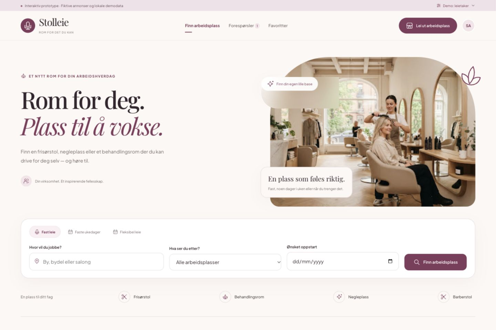

# Stolleie — markedsplassprototype

[Åpne prototypen](https://kapsdevelopment.github.io/stoler/) · [GitHub-repository](https://github.com/kapsdevelopment/stoler) · [Publisering og tester](https://github.com/kapsdevelopment/stoler/actions)

En responsiv og interaktiv markedsplassprototype basert på Stitch-skissene. Den originale eksporten ligger urørt i `stitch_boutique_salon_workspace_marketplace/`.



## Hosting og versjonering

Hele prosjektet er versjonert med Git, inkludert originalskisser, tester og dokumentasjon. GitHub Actions kjører syntakskontroll og tester før hver publisering. Endringer som pushes til `main`, publiseres automatisk til GitHub Pages. Pull requests testes uten å publisere.

`npm run build` lager `dist/` med kun nettsidens kjørefiler og assets. Originalskisser, ZIP-arkiv, lokale startfiler og tester publiseres ikke som del av nettsiden. Genererte filer i `dist/` sjekkes ikke inn i Git.

Nettsiden er en offentlig demo. Innhold du oppretter i prototypen, lagres fremdeles bare i din egen nettleser. Nettsiden ber søkemotorer om å ikke indeksere demoen.

## Start

Krever Node.js 20 eller nyere. Ingen installasjon av pakker er nødvendig.

```sh
cd /Users/ken/Documents/Utvikling/stoler
npm start
```

Åpne [http://127.0.0.1:4177](http://127.0.0.1:4177). Stopp med Ctrl+C. Bruk `PORT=4180 npm start` dersom porten er opptatt. Serveren serverer bare statiske filer på den lokale maskinen; den har ingen API-er eller database.

På Mac kan du også dobbeltklikke `Start Stolleie.command` i Finder for å starte den lokale serveren.

## Prøv de to flytene

**Leietaker:** Søk etter plass → velg leieform, oppstart og eventuelle dager → send en forespørsel → åpne dialogen. Velg «Prøv som utleier», svar og foreslå visning. Bytt tilbake til leietaker for å bekrefte tidspunktet.

**Utleier:** Velg «Lei ut arbeidsplass» → opprett annonse i fire steg → publiser → prøv annonsen som leietaker → send en forespørsel. Utleier kan også redigere og pause annonsen. «Lagre utkast» lar deg fortsette senere.

Demomenyen øverst lar deg bytte mellom fiktive utleiere og nullstille demoen. Den utleieren som mottar en ny forespørsel, velges automatisk for neste rollebytte.

## Demodata og avgrensning

- Åtte fiktive annonser i Oslo, Bergen og Trondheim, med fast leie, faste ukedager og fleksible dager.
- Annonser, forespørsler, meldinger og favoritter lagres i nettleserens `localStorage`. De deles ikke mellom nettlesere eller enheter.
- Ingen ekte kontoer, meldingssending, avtaler, betalinger eller garantier. En avtalt visning er ikke en leieavtale.
- Bilder og fonter er lastet ned fra eksportens kilder og lagres i `assets/`. Prototypen fungerer uten eksterne nettverkskall etter at den lokale serveren er startet.
- Eget annonsebilde kan velges lokalt. Det skaleres ned før lagring. Store mengder bilder kan fylle nettleserens lagringskvote; appen viser i så fall beskjed og beholder økten i minnet.
- Tilgjengelighet er illustrerende, og datoer bekreftes i dialog med utleier. Prototypen reserverer ikke faktiske lokaler.

## Struktur og verifisering

- `index.html`, `styles.css`, `app.js`: grensesnitt, komponenter og brukerflyter.
- `data.js`: demoinnhold og starttilstand.
- `domain.js`: søk, datoer, prisberegning og validering.
- `server.mjs`: lokal statisk forhåndsvisning uten avhengigheter.
- `tests/domain.test.mjs`: tester av pris, filtrering, tilgjengelighet og gjenoppretting av data.

Kjør `npm test` for testene og `npm run check` for syntakskontroll.
